 

 

🇹🇷 Ankara'da yaşayan bir **full-stack yazılım geliştiriciyim** ve **ERN Yazılım**'ın kurucusuyum. Web, mobil ve masaüstü yazılımlar geliştiriyor; freelance projelerin yanında **SEO** ve **sunucu / DevOps** işleriyle ilgileniyorum. Bilgisayar donanımına da hakimim.

🌐 I'm a **full-stack software developer** based in Ankara, Türkiye, and the founder of **ERN Yazılım**. I build web, mobile and desktop software, and also take on freelance development, **SEO** and **server / DevOps** work. I'm comfortable with computer hardware too.

 

 

&nbsp;
&nbsp;

 

